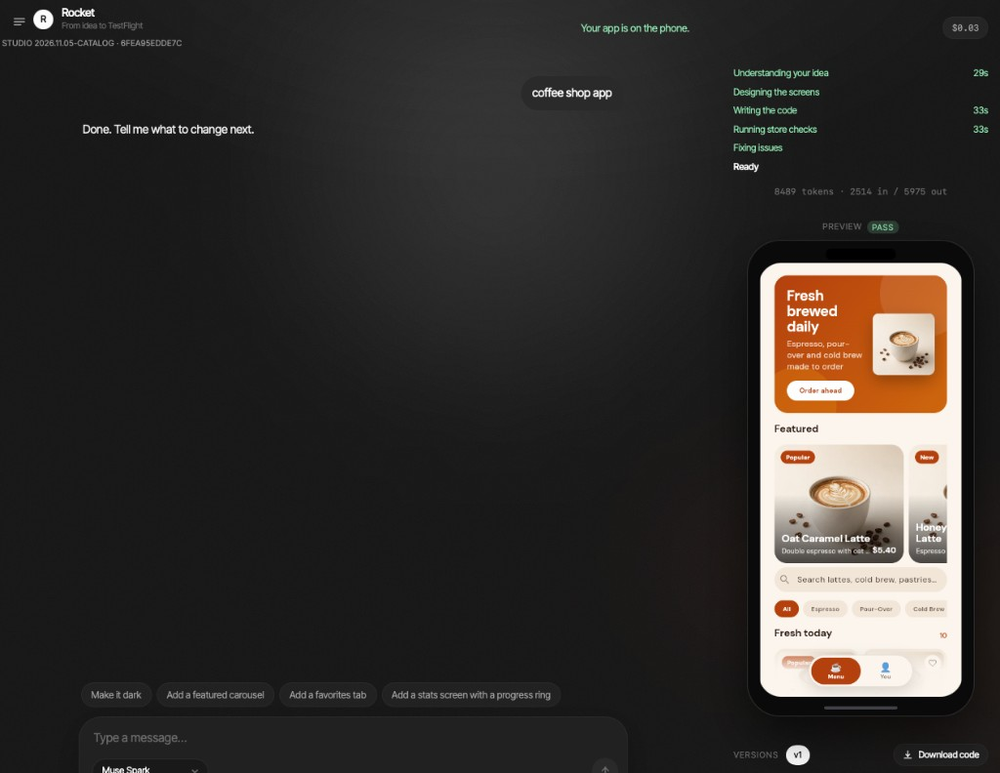

# Rocket

The harness is the rocket. The model is the pilot.

Rocket is a model-agnostic harness that turns an app idea into a verified, store-ready Flutter app and can ship it to TestFlight under the user's own developer account. Product goal: [docs/VISION.md](docs/VISION.md).

This repository is **new work written during the Meta Global AI Developer Hackathon (Oct 27 – Nov 4 2026)**.



*The studio after one prompt ("coffee shop app"): Muse Spark returned the app's data, the harness wrote the screens from the locked design kit, and the gate passed. The preview is the Flutter web build.*

## Why this exists

Building the app is no longer the hard part. The repeated plumbing around it is: auth, onboarding, paywall, privacy and terms, account deletion, store metadata, signing, upload. Every app repeats it, and every repetition brings the same bugs. Rocket locks that plumbing into a protected capsule, lets any model that can emit JSON design the rest, and lets a deterministic gate (not a model) decide whether the result is ready.

## NEW vs PRE-EXISTING

Everything in this repo was written this week. The private Ive product is **not included**.

| Item | Status |
| --- | --- |
| This repository (capsule, Pilot layer, studio, gate, ship, docs) | **NEW** this week |
| Private Ive product | **Not included** |
| Protected-file guard (pilot cannot edit `lib/core/`) | Pre-existing **concept**, reimplemented here in `src/harness/guard.py` |
| File-ops format (write / patch / delete JSON) | Pre-existing **concept**, reimplemented in `src/harness/apply.py` |
| Compile-and-repair loop | Pre-existing **idea**, reimplemented as a gate-driven loop (max 2 rounds) in `src/harness/build.py` |

Module-by-module authorship and dates: [HACKATHON_SCOPE.md](HACKATHON_SCOPE.md).

## What it does

1. **Capsule** (`flutter_template/`): a Flutter app with a protected `lib/core/` (router, auth and billing interfaces, onboarding, paywall with subscription disclosure, settings with account deletion, terms, privacy) and an editable `lib/app/`.
2. **Pilot** (`src/pilot/`): any model that can return JSON. Muse Spark (`muse-spark-1.3`) is the primary pilot; Muse Spark Open (via an OpenAI-compatible endpoint) is selectable; an offline FakePilot drives tests and the demo mode.
3. **Design engine**: 11 curated palettes (WCAG AA, light and dark) chosen from the idea, or switched by an instruction such as "make it dark". A token-driven kit (`lib/core/kit/`) with fonts and 24 bundled product photos generated with Muse Image.
4. **Catalog writer**: in harness mode the model returns only an `AppCatalog` JSON (products, copy, tab labels). `src/harness/kit_writer.py` writes the Dart for the shop, detail and profile screens from the kit, so the model never writes page layout.
5. **Guard**: file operations are validated against `capsule.manifest.json`; writes to protected paths are rejected and fed back.
6. **Gate** (`harness gate`): `flutter analyze`, `flutter test`, optional web build, and **15 preflight checks** ([docs/preflight.md](docs/preflight.md)). Up to 2 repair rounds, fed only by gate failures.
7. **Studio** (`harness ui`): a chat. The first message builds an app; later messages improve the same app. Projects sidebar, versions (restoring a version forks it), code download as a zip with secrets excluded, live build steps, cost, and a store-check sheet.
8. **Store pack and ship**: listing copy, privacy template, Muse Image icon (`harness storepack`); `harness ship --target testflight` with credentials from the environment or Keychain only.
9. **Sweep and report**: `harness sweep` runs ideas x pilots x modes (`harness`, `scaffold_only`, `bare`) and classifies infra failures separately from quality failures; `harness report` writes a counts-only table.

## Reproduce in under 5 minutes (offline)

Needs [uv](https://docs.astral.sh/uv/) (Python 3.11) and [Flutter](https://flutter.dev/). No API key. Uses FakePilot canned JSON plus the deterministic gate.

```bash
git clone https://github.com/NurdauletYN/ive-meta-hackathon.git
cd ive-meta-hackathon
uv sync --all-extras
cd flutter_template && flutter pub get && cd ..
uv run pytest
uv run harness gate flutter_template --build-web
```

`pytest` covers FakePilot, guard, preflight, ship (fake subprocess; no Apple), storepack (FakePilot; mock icon), sweep (fake), report, the design engine, the catalog writer, and the studio API. `harness gate` runs `flutter analyze`, `flutter test`, `flutter build web`, and preflight. Do **not** run `harness sweep` unless you intend a live, budgeted eval.

## Studio

```bash
uv run harness ui --port 8765
```

Open http://127.0.0.1:8765/ and type an app idea. Offline: Model and spend → Offline demo (no API). Live Muse Spark needs `META_API_KEY` in `.env` (from `.env.example`) and a spend cap. The header shows the studio build and a fingerprint; restart the server after pulling new code so it matches the terminal line.

## Results

The harness-vs-no-harness comparison (`harness sweep` then `harness report`) is **implemented and tested with FakePilot, but no published result exists.** [ivebench/results/results.md](ivebench/results/results.md) is **0/0** by design: the committed tree has no classified sweep JSON, and local untracked sweep files are not a published result. Rocket makes no claim that the harness beats a bare model, or that a cheap model inside it matches a strong one, because that has not been measured here.

What does exist, and is labeled as such:

- **Usage and spend** from `ivebench/results/usage.jsonl`, in [METAUSE.md](METAUSE.md) (generated by `uv run harness usage-report --write-metause`; offline FakePilot rows excluded). That is spend, not quality.
- **A small live quality check**: three Muse Spark harness builds under a $1.50 cap, all three completed builds passed the gate ([docs/quality_check.md](docs/quality_check.md)). It predates the catalog writer and is not the 8-idea sweep.

Re-generate the (empty) table with `uv run harness report`.

## Limits

- No published harness-vs-bare comparison (see Results). Idea set is small (`ivebench/ideas.jsonl`, 8 ideas; banned topics excluded).
- Capsule auth and billing are **in-memory mocks** unless the user supplies Firebase / RevenueCat config. Those adapters are config-gated and **unverified** on a real device or sandbox purchase.
- `harness ship` to TestFlight is **unverified** in this repo: tests use a fake subprocess runner, and there was no live Apple call. Public TestFlight links need Beta App Review and are not automated. See [docs/ship.md](docs/ship.md).
- Preflight checks were designed around this capsule, and their pass rates are **not** Apple rejection rates. A green gate is not App Review. The privacy text is a template, not legal advice.
- Muse Spark Open has **no live calls** in the usage log; every build and number here used Muse Spark (`muse-spark-1.3`) or the offline FakePilot.
- Generated apps use bundled photos and in-memory data. The studio runs on 127.0.0.1 only and does not run storepack or ship (CLI only, so Apple keys never reach the browser).

## Security notes

- Never commit `.env`, `*.p8`, `GoogleService-Info.plist`, `google-services.json`, `firebase_options.dart`, `revenuecat_api_key.txt`, or `lib/revenuecat_key.dart`.
- Credentials are read from the environment or macOS Keychain. They are never passed to a Pilot. Logs and `ship_report.json` are redacted.
- Do not paste secrets into chat. Rotate any key that was.
- `gitleaks` runs on commit (pre-commit hook) and over history in `scripts/prepublish_check.sh`.

## License

MIT. See [LICENSE](LICENSE).

## Third-party licenses

Python (see `uv.lock`): httpx, pydantic, python-dotenv, pillow; pytest and pre-commit for development. Flutter capsule: Flutter SDK, cupertino_icons, go_router, flutter_markdown, flutter_lints, firebase_core, firebase_auth, purchases_flutter, flutter_launcher_icons; DM Sans (bundled font, SIL Open Font License). Each keeps its upstream license. Product photos in the kit were generated with Muse Image. The studio footer credits the model that actually built the app; "Built with Muse Spark Open" appears only when that pilot ran.

## Layout

| Path | Role |
| --- | --- |
| `docs/VISION.md` | Product goal |
| `flutter_template/` | Capsule (`lib/core/` protected, `lib/app/` editable, `lib/core/kit/` design kit) |
| `src/harness/` | Guard, gate, design, build, catalog writer, repair, palettes, projects, sweep, report, ship, studio |
| `src/pilot/` | `complete_json` protocol, Fake / Muse Spark / OpenAI-compat |
| `src/preflight/` | Deterministic store-readiness checks (15) |
| `src/meta_client/` | Muse Spark + Muse Image adapters |
| `src/storepack/` | Listing copy, privacy template, icon zip |
| `demo/` | Studio static files |
| `docs/ship.md` | TestFlight prerequisites and what is not automated |
| `docs/storepack.md` | Store pack commands; privacy is a template, not legal advice |
| `docs/firebase.md` | Config-gated Firebase auth; unverified on device |
| `docs/revenuecat.md` | Config-gated RevenueCat billing; unverified until a sandbox purchase |
| `docs/preflight.md` | Check descriptions (not legal advice) |
| `docs/kit_api.md` | Kit API shown to the pilot |
| `docs/quality_check.md` | Small live quality check |
| `METAUSE.md` | Meta model jobs + generated usage table |
| `scripts/prepublish_check.sh` | Submission hygiene |
